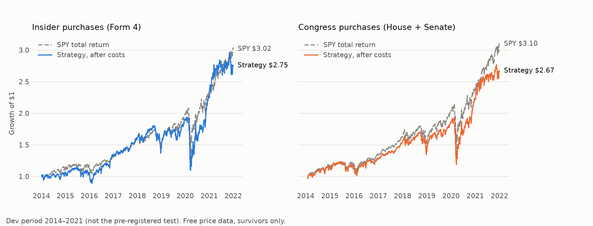

# copy-the-insiders

**Does copying what corporate insiders and members of Congress buy beat the market, if you only
buy after their trades become public?**

A pre-registered backtest on 12 years of SEC Form 4 filings and House and Senate
periodic transaction reports. The rules, the primary metric and the decision rule are fixed in
[`prereg/prereg.yaml`](prereg/prereg.yaml) *before* the test period is run. The code currently
refuses to compute any test-period returns; the one-time run will only proceed once the config
matches its git tag.

> **Status:** rules nearly final; the one-time test-period run (2022 – mid-2026) has not happened
> yet. Everything below is from the **development period (2014–2021)**, which was used to build
> and debug, not to test.



## What the dev period shows so far

The primary metric is **alpha against the Fama-French 5 factors plus momentum** (annualized,
95% block-bootstrap CI), not raw return vs SPY. The insider strategy leans heavily toward small
and value stocks (size loading +0.66, value +0.29). Measured against SPY, that tilt looks like
noise or skill; the factor model separates it out and cuts the noise by about two-thirds.

| | Insider purchases | Congress purchases |
|---|---|---|
| Factor alpha, primary rules | **+2.2%** [+0.5%, +5.6%] | **−0.4%** [−2.4%, +2.3%] |
| …with 25 bps trading costs | +1.2% [−0.3%, +4.8%] | −1.4% [−3.5%, +1.3%] |
| …adding delisted stocks at 0% return | +0.8% [−0.7%, +3.6%] | −0.1% [−2.0%, +2.2%] |
| Smallest alpha the test can detect (80% power) | 4.9% / yr | 4.6% / yr |
| Signals used | 29,650 | 10,173 |

**Reading it honestly:** the insider edge in the dev period is small and fragile. It disappears
under higher costs or a fair allowance for companies missing from free price data. Congress shows
nothing in any variant. Neither dev result decides anything: the pre-registered test does, and it
can only detect edges of about 5% a year or more. A smaller true edge would come out
*inconclusive*, and the write-up will say so rather than call it "no effect".

Full tables: [insider](reports/dev_results/SUMMARY.md) · [Congress](reports/dev_results/SUMMARY_congress.md)

## What makes it rigorous

- **Pre-registration with a code lock.** The config is hashed and tagged in git; the test run
  checks the hash against the tag and records itself in `RUN.json`, so a rerun is visible. Every rule changed after dev returns were
  first seen is in a [changelog](prereg/PREREG.md#changelog) with a reason that isn't about returns.
- **No look-ahead.** Entry is the open of the first trading day *after* the filing date. Market cap
  uses only share counts already published by then. A dedicated test fails if any trade could
  have used future information.
- **Survivorship bounds.** Free price data mostly lacks delisted companies, and more of them in
  older years (59% of dev-period insider purchases match a priced stock vs 83% in the test period).
  Instead of hiding that, every result is rerun with the missing purchases added back at −100%,
  0% and SPY returns.
- **Power analysis up front.** The minimum detectable alpha is computed before the test, so an
  inconclusive result can't be passed off as evidence of no effect.
- **Sensitivity runs that change one thing at a time:** costs, holding period, rebalancing rule,
  filing-lag cutoff, 10b5-1 plan classification, match confidence, trade-size weighting.
- **Holm adjustment** across the two groups; a sector-ETF clone as a secondary benchmark.
- **Hand audits** of 100 random matches per group, reported with a confidence interval.

## Data

| Source | What | Scale |
|---|---|---|
| SEC Form 4 datasets, 2014–2026 | Officer and director open-market purchases (code P, ≥ $10k, not under a 10b5-1 plan, common stock only) | 163,611 candidate purchases |
| House Clerk PTRs, 2015– | Electronic PDF reports, parsed from text layout | 7,738 reports, 45,524 stock trades |
| Senate eFD PTRs, 2012– | HTML reports | 2,138 reports, 10,060 stock trades |
| SEC XBRL frames, submissions API | Point-in-time shares outstanding; industry codes | |
| yfinance, Treasury, Ken French library | Daily prices; T-bill rates; factor returns | ~5,000 securities |

Coverage gaps are measured, not assumed away: see [`reports/data_quality.md`](reports/data_quality.md)
and [`reports/data_quality_congress.md`](reports/data_quality_congress.md) (match rates by year,
paper-filed reports, members who only file on paper).

## Bugs the checks caught

- **Two price series under one company.** Some Congress trades were reported under both an ADR and
  a foreign ordinary share (Barclays BCS / BCLYF). Stored together, they produced ±300% daily
  moves and a fake +10% alpha. Fixed with one price ticker per company and an engine guard that
  rejects duplicate prices.
- **Ticker reuse.** SHLD was Sears and is now a defense ETF. 3.5% of insider purchases map to a
  ticker whose price history starts after the trade; they're excluded, never mispriced.
- **Survivorship bounds counted every repeat buy as a new position**, giving −79% a year. Fixed by
  grouping repeat buys of one company into episodes.

## Run it

SEC asks for a contact User-Agent. In PowerShell `$env:SEC_USER_AGENT = "Your Name you@example.com"`,
in bash `export SEC_USER_AGENT="Your Name you@example.com"`. Then:

```bash
uv sync
```
```bash
uv run cti all
```

`cti all` downloads the data, builds the warehouse, and runs the tests. `--skip-ingest` rebuilds
from data already downloaded. A full first download takes several hours (rate-limited, polite
clients; raw files are kept immutable with checksums).

| Command | What it does |
|---|---|
| `cti ingest form4 / reference / prices / shares` | SEC insider data; T-bills, tickers, SPY and sector ETFs; prices; share counts |
| `cti ingest congress` / `cti ingest senate` | House PTR PDFs / Senate eFD reports, parsed to staging tables |
| `cti build` · `cti resolve` · `cti resolve-congress` | SQL models into DuckDB; match trades to securities; data-quality reports |
| `cti signals` | Universe filter (price ≥ $5, market cap ≥ $300M, listed exchange) and buy/sell signals |
| `cti run --period dev --group insider\|congress` | Dev backtest with every pre-registered sensitivity run |
| `cti audit score` | Score the hand audits |
| `cti prereg hash` / `cti prereg tag` | Hash / tag the pre-registration |

**Stack:** Python 3.12, DuckDB + Parquet, pandas/NumPy, Typer, pytest (114 tests, including
hand-calculated engine cases), ruff, GitHub Actions.

## Status

- [x] Data: SEC Form 4, House and Senate PTRs, prices, share counts, factors
- [x] Backtest engine, statistics, sensitivity and survivorship runs; dev-period results
- [ ] Hand audits of security matches
- [ ] Tag the pre-registration; one-time test-period run
- [ ] Forward period (2026-07 to 2028-06), pre-registered with a fixed end date

See [`prereg/PREREG.md`](prereg/PREREG.md) for every rule, its rationale, and the known
measurement issues.
